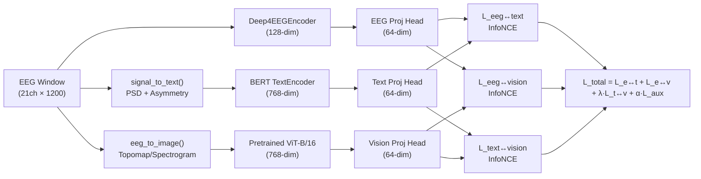

# Multimodal EEG-CLIP: Implementation Plan

## Architecture Overview

## New Files

| File | Purpose |
|---|---|
| `data/signal_to_text.py` | Compute PSD per band per channel group → generate individualized clinical text |
| `data/eeg_to_image.py` | Convert EEG windows → topomap and/or spectrogram images (224×224) |
| `models/vision_encoder.py` | Pretrained ViT-B/16 from torchvision, frozen backbone + trainable proj head |

## Modified Files

| File | Changes |
|---|---|
| `config.py` | Add `use_vision_encoder`, `vision_encoder_name`, `vision_lr_ratio`, `vision_loss_weight`, `text_vision_loss_weight`, `image_size`, `use_signal_text` flags |
| `data/dataset.py` | In `__getitem__` + `_load_cache` + `_build_index`: call `signal_to_text()` on window data; optionally precompute topomap/spectrogram image |
| `models/eeg_clip.py` | Add `EEGCLIPMultimodal(EEGCLIPPlusPlus)` with vision branch + 3-way loss |
| `train.py` | Handle vision modality in training loop, new CLI flags |
| `evaluate.py` | Support vision-based zero-shot (EEG↔image similarity) |
| `compare_eeg_vs_text.py` | Add EEG+Vision column |

## Implementation Order

1. **`data/signal_to_text.py`** — Signal-derived text (standalone, testable)
2. **`data/eeg_to_image.py`** — Topomap + spectrogram generation (standalone, testable)
3. **`models/vision_encoder.py`** — ViT wrapper (standalone, testable)
4. **`config.py`** — New config flags
5. **`data/dataset.py`** — Wire signal_to_text + eeg_to_image into dataset
6. **`models/eeg_clip.py`** — `EEGCLIPMultimodal` class
7. **`train.py`** — Multimodal training loop
8. **`evaluate.py`** / **`compare_eeg_vs_text.py`** — Updated evaluation
